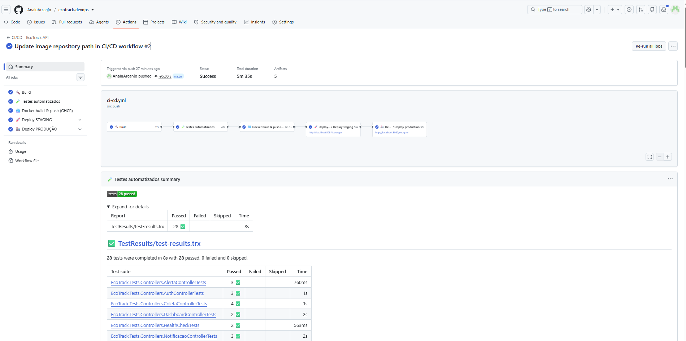
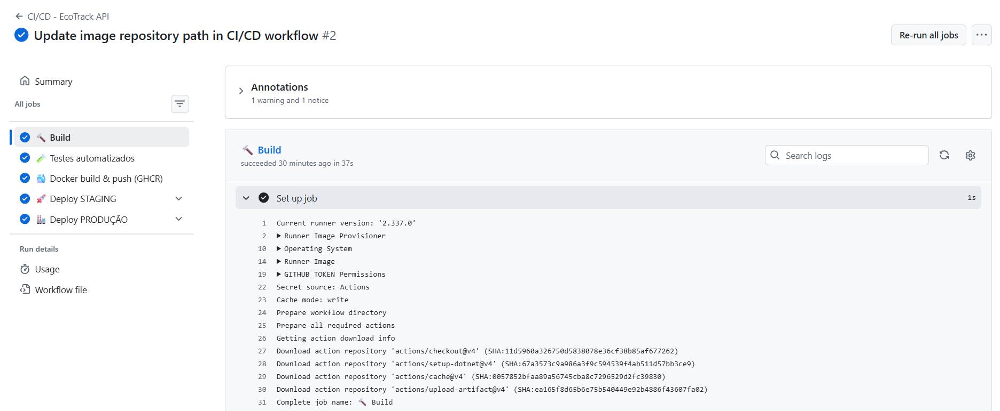
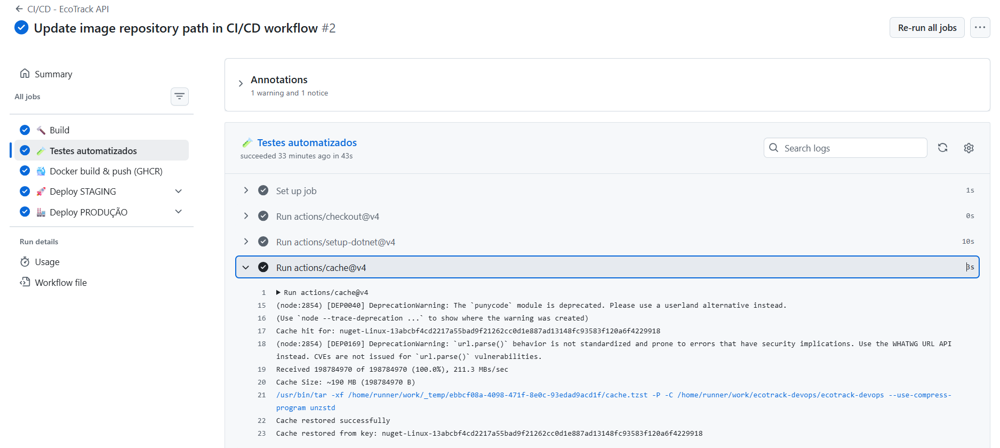
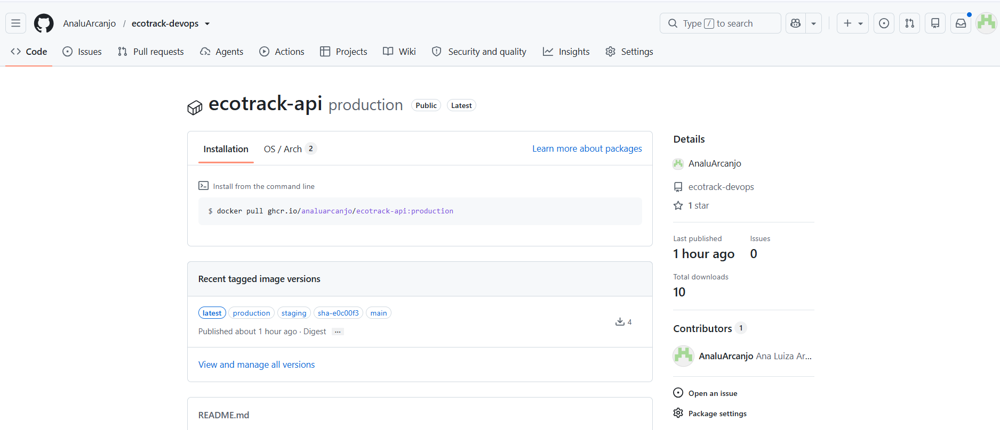
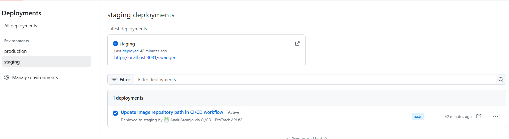
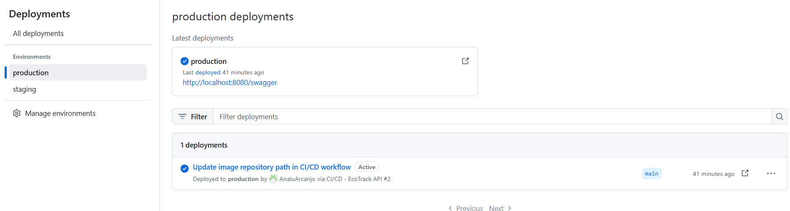
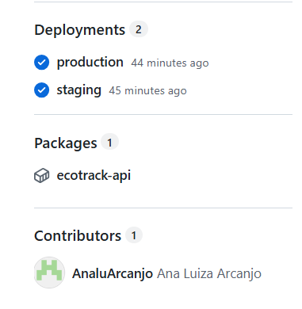

# Projeto - Cidades ESGInteligentes

**EcoTrack API** — sistema de Gestão de Resíduos e Reciclagem (ESG) desenvolvido em **C# / .NET 8**, agora com ciclo de vida completo de DevOps: **pipeline CI/CD no GitHub Actions**, **containerização com Docker**, **orquestração com Docker Compose** e **deploy automatizado em dois ambientes (staging e produção)**.

| | |
|---|---|
| **Integrantes** | Ana Luiza Arcanjo — RM 562568 · |
| **Turma** | 2TDSOA — FIAP |
| **Repositório** | `https://github.com/AnaluArcanjo/ecotrack-devops` |
| **Imagem Docker** | `ghcr.io/analuarcanjo/ecotrack-api` |

A API faz o rastreamento de coleta seletiva, pontos de coleta, alertas de ocupação, notificações e relatórios de impacto ambiental (CO₂ evitado). Arquitetura em camadas (Domain, Application, Infrastructure, API), autenticação JWT, EF Core com migrations e SQL Server.

---

## Estrutura do projeto

```
EcoTrackNet-DevOps/
├── .github/workflows/
│   ├── ci-cd.yml                  # Pipeline principal: build → testes → imagem → staging → produção
│   └── deploy.yml                 # Workflow reutilizável de deploy (usado por staging e produção)
├── deploy/
│   ├── staging.env.example        # Variáveis do ambiente de staging
│   └── production.env.example     # Variáveis do ambiente de produção
├── scripts/
│   ├── deploy.sh                  # Sobe um ambiente (staging|production) e aguarda o health check
│   └── smoke-test.sh              # 9 verificações pós-deploy (health, banco, JWT, segurança)
├── src/
│   ├── EcoTrack.Domain/           # Entidades, enums, interfaces
│   ├── EcoTrack.Application/      # ViewModels, serviços, validações (FluentValidation)
│   ├── EcoTrack.Infrastructure/   # EF Core, repositórios, migrations
│   └── EcoTrack.API/              # Controllers, middleware, Program.cs, appsettings.{Ambiente}.json
├── tests/EcoTrack.Tests/          # Testes xUnit de integração (WebApplicationFactory + InMemory)
├── docs/
│   ├── prints/                    # Evidências (prints do pipeline e dos ambientes)
│   └── insomnia/                  # Coleção de requisições da API
├── Dockerfile                     # Build multi-stage (.NET SDK → ASP.NET runtime)
├── docker-compose.yml             # API + SQL Server (volumes, redes, variáveis, healthchecks)
├── docker-compose.staging.yml     # Override do ambiente de staging
├── docker-compose.prod.yml        # Override do ambiente de produção
├── .env.example                   # Variáveis para execução local
└── EcoTrackNet.sln
```

---

## Como executar localmente com Docker

**Pré-requisitos:** Docker + Docker Compose v2 (Docker Desktop no Windows/Mac, ou Docker Engine no Linux).

```bash
# 1. Clonar o repositório
git clone https://github.com/AnaluArcanjo/ecotrack-devops.git
cd cd ecotrack-devops

# 2. Criar o arquivo de variáveis de ambiente
cp .env.example .env

# 3. Build da imagem e subida dos containers (API + SQL Server)
docker compose up -d --build

# 4. Acompanhar a inicialização (o SQL Server leva ~30s; as migrations rodam sozinhas)
docker compose ps
docker compose logs -f api
```

| Recurso | URL |
|---|---|
| Swagger UI | http://localhost:8080/swagger |
| Health check | http://localhost:8080/health |

Usuário administrador criado pela migration: `admin@ecotrack.com.br` / `Admin@123`.

**Simulando os dois ambientes localmente** (mesmos comandos usados pelo pipeline):

```bash
./scripts/deploy.sh staging        # API em http://localhost:8081 (ASPNETCORE_ENVIRONMENT=Staging)
./scripts/deploy.sh production     # API em http://localhost:8080 (ASPNETCORE_ENVIRONMENT=Production)

./scripts/smoke-test.sh http://localhost:8081 Staging
./scripts/smoke-test.sh http://localhost:8080 Production
```

**Rodando os testes dentro do Docker** (sem instalar o .NET): `docker build --target test .`

**Parar e remover:** `docker compose down` (adicione `-v` para apagar também o volume do banco).

> 💡 **Sem Docker na máquina** (por exemplo, sem virtualização habilitada)? Abra o repositório no **GitHub Codespaces** (botão *Code → Codespaces → Create codespace*), que já vem com Docker, e rode os mesmos comandos no terminal. As portas 8080/8081 aparecem na aba *Ports*.

---

## Pipeline CI/CD

**Ferramenta:** GitHub Actions (`.github/workflows/ci-cd.yml` + `.github/workflows/deploy.yml`)
**Registry de imagens:** GitHub Container Registry (GHCR)

```
 push / PR
    │
    ▼
┌─────────┐   ┌──────────┐   ┌──────────────────┐   ┌──────────────────┐   ┌───────────────────┐
│  Build  │──▶│  Testes  │──▶│ Docker build +   │──▶│ Deploy STAGING   │──▶│ Deploy PRODUÇÃO   │
│ (.NET)  │   │ (xUnit)  │   │ push no GHCR     │   │ + smoke tests    │   │ + smoke tests     │
└─────────┘   └──────────┘   └──────────────────┘   └──────────────────┘   └───────────────────┘
                                                      tag :staging            tag :production
                                                                              (aprovação manual
                                                                               opcional)
```

### Etapas

| # | Job | O que faz |
|---|---|---|
| 1 | **🔨 Build** | Checkout, instala o .NET 8, restaura pacotes NuGet (com cache), compila a solução em `Release` e publica a API como artefato (`ecotrack-api-build`). |
| 2 | **🧪 Testes automatizados** | Executa os testes xUnit (`dotnet test`) com coleta de cobertura. Gera relatório `.trx`, publica o resultado na aba *Checks*, no resumo da execução e como artefato (`test-results`). Se algum teste falhar, o pipeline para aqui. |
| 3 | **🐳 Docker build & push** | Faz o build da imagem com o `Dockerfile` (Buildx + cache), injeta o SHA do commit como versão e publica no GHCR com as tags `sha-xxxxxxx`, nome da branch e `latest`. |
| 4 | **🚀 Deploy STAGING** | Usa o GitHub Environment `staging`: gera o `deploy/staging.env` a partir dos *secrets*, faz `pull` da imagem exata do commit, sobe API + SQL Server com `docker-compose.yml` + `docker-compose.staging.yml`, aguarda o health check e roda os **smoke tests**. Se passar, promove a imagem para a tag `:staging`. |
| 5 | **🏭 Deploy PRODUÇÃO** | Só roda na branch `main` e **somente se staging passou**. Usa o GitHub Environment `production` (que pode exigir aprovação manual), sobe com `docker-compose.prod.yml`, roda os smoke tests e promove a imagem para `:production`. |

### Gatilhos

| Evento | O que roda |
|---|---|
| Pull request para `main` | Build + Testes (CI) |
| Push em `develop` | Build + Testes + Imagem + Deploy **staging** |
| Push em `main` ou execução manual (*Run workflow*) | Pipeline completo: staging **e** produção |

### Smoke tests pós-deploy (`scripts/smoke-test.sh`)

Após cada deploy, 9 verificações são feitas na API rodando no ambiente:
health check · ambiente correto (`Staging`/`Production`) · Swagger · leitura no banco (seed) · listagem paginada · cadastro de usuário (escrita no banco) · login JWT · endpoint protegido com token (200) · endpoint protegido sem token (401).
O resultado aparece em tabela no **resumo da execução** do GitHub Actions, e os logs dos containers ficam salvos como artefatos (`evidencias-staging`, `evidencias-production`).

### Ambientes

| | Staging | Produção |
|---|---|---|
| GitHub Environment | `staging` | `production` (com *required reviewers* opcional) |
| `ASPNETCORE_ENVIRONMENT` | `Staging` | `Production` |
| Porta da API | 8081 | 8080 |
| Banco | `EcoTrackDb_Staging` (volume `sqlserver_data_staging`) | `EcoTrackDb` (volume `sqlserver_data_production`) |
| Log level | Information | Warning |
| Limites | 1 CPU / 512 MB | 2 CPU / 1 GB |
| Expiração do JWT | 120 min | 60 min |
| Tag da imagem | `:staging` | `:production` |

> **Onde os ambientes rodam:** o deploy sobe os containers em um runner Linux do GitHub Actions (que já tem Docker), usando exatamente a mesma imagem publicada no GHCR e os mesmos arquivos Compose que seriam usados num servidor. Os ambientes são temporários: ficam no ar durante o job, que valida tudo com os smoke tests e salva logs e evidências antes de encerrar. Para um servidor permanente (VM na Azure/AWS, por exemplo), basta executar o mesmo `scripts/deploy.sh` nele, via SSH, a partir do pipeline.

### Configuração no GitHub (uma vez)

1. *Settings → Environments* → criar **`staging`** e **`production`**.
2. (Opcional, recomendado) em `production`, marcar **Required reviewers** → o deploy em produção passa a esperar aprovação manual.
3. (Opcional) em cada environment, cadastrar os *secrets* `SA_PASSWORD` e `JWT_SECRET` (sem espaços nem `$`). Se não forem cadastrados, o pipeline usa valores de demonstração.
4. *Settings → Actions → General → Workflow permissions*: **Read and write permissions** (para publicar no GHCR).

---

## Containerização

### Dockerfile

```dockerfile
# ---------- Stage 1: build ----------
FROM mcr.microsoft.com/dotnet/sdk:8.0 AS build
WORKDIR /src
COPY ["EcoTrackNet.sln", "./"]
COPY ["src/EcoTrack.API/EcoTrack.API.csproj", "src/EcoTrack.API/"]
COPY ["src/EcoTrack.Application/EcoTrack.Application.csproj", "src/EcoTrack.Application/"]
COPY ["src/EcoTrack.Domain/EcoTrack.Domain.csproj", "src/EcoTrack.Domain/"]
COPY ["src/EcoTrack.Infrastructure/EcoTrack.Infrastructure.csproj", "src/EcoTrack.Infrastructure/"]
COPY ["tests/EcoTrack.Tests/EcoTrack.Tests.csproj", "tests/EcoTrack.Tests/"]
RUN dotnet restore "EcoTrackNet.sln"
COPY . .
RUN dotnet build "EcoTrackNet.sln" -c Release --no-restore

# ---------- Stage 2: test (docker build --target test .) ----------
FROM build AS test
RUN dotnet test "EcoTrackNet.sln" -c Release --no-build --verbosity normal

# ---------- Stage 3: publish ----------
FROM build AS publish
RUN dotnet publish "src/EcoTrack.API/EcoTrack.API.csproj" -c Release -o /app/publish \
    --no-restore /p:UseAppHost=false

# ---------- Stage 4: runtime ----------
FROM mcr.microsoft.com/dotnet/aspnet:8.0 AS final
ARG APP_VERSION=local
WORKDIR /app
RUN apt-get update && apt-get install -y --no-install-recommends curl \
    && rm -rf /var/lib/apt/lists/*
RUN addgroup --system ecotrack && adduser --system --ingroup ecotrack ecotrack
COPY --from=publish --chown=ecotrack:ecotrack /app/publish .
USER ecotrack
EXPOSE 8080
ENV ASPNETCORE_URLS=http://+:8080 \
    ASPNETCORE_ENVIRONMENT=Production \
    AutoMigrate=true \
    APP_VERSION=${APP_VERSION}
HEALTHCHECK --interval=30s --timeout=10s --start-period=60s --retries=3 \
  CMD curl -fsS http://localhost:8080/health || exit 1
ENTRYPOINT ["dotnet", "EcoTrack.API.dll"]
```

### Estratégias adotadas

- **Multi-stage build:** o SDK (~800 MB) só existe nas etapas de build; a imagem final usa apenas o runtime ASP.NET (~220 MB).
- **Cache de camadas:** os `.csproj` são copiados antes do código, então o `dotnet restore` só é refeito quando as dependências mudam. No CI, o Buildx ainda usa o cache do GitHub Actions (`type=gha`).
- **Etapa de testes no Dockerfile:** `docker build --target test .` roda os testes dentro do container.
- **Segurança:** a aplicação roda com usuário sem privilégios (`ecotrack`), e os segredos vêm de variáveis de ambiente, nunca da imagem (`.env` e `deploy/*.env` estão no `.gitignore` e no `.dockerignore`).
- **Health check:** o `HEALTHCHECK` chama `/health`, que retorna status, ambiente e versão (SHA do commit).
- **Versionamento:** a imagem recebe o SHA do commit (`APP_VERSION`) e tags imutáveis `sha-xxxxxxx`. A mesma imagem testada em staging é a promovida para produção.
- **Migrations automáticas:** com `AutoMigrate=true`, o EF Core cria/atualiza o schema no startup.

### Orquestração (Docker Compose)

| Recurso | Uso |
|---|---|
| **Serviços** | `api` (EcoTrack .NET 8) e `sqlserver` (SQL Server 2022) |
| **Volumes** | `sqlserver_data` / `sqlserver_data_staging` / `sqlserver_data_production`: dados do banco persistem entre deploys, e cada ambiente tem o seu |
| **Redes** | `backend` (API ↔ banco, interna) e `frontend` (API exposta) |
| **Variáveis de ambiente** | `.env` (local) e `deploy/<ambiente>.env` (gerado pelo pipeline a partir dos secrets): senha do banco, chave JWT, portas, imagem, versão |
| **Healthchecks** | O banco usa `sqlcmd SELECT 1` e a API usa `/health`. A API só sobe depois que o banco está saudável (`depends_on: condition: service_healthy`) |
| **Overrides por ambiente** | `docker-compose.staging.yml` e `docker-compose.prod.yml` mudam ambiente, volume, limites de CPU/memória e política de restart |
| **Logs** | Driver `json-file` com rotação (10 MB × 3 arquivos) |

---

## Prints do funcionamento

> Os logs completos de cada deploy podem ser baixados nos artefatos da execução (`evidencias-staging`, `evidencias-production`, `test-results`).

**Execução completa do pipeline (build → testes → imagem → staging → produção, tudo verde):**
https://github.com/AnaluArcanjo/ecotrack-devops/actions/runs/38478812109

| Job | Link |
|---|---|
| 🔨 Build | https://github.com/AnaluArcanjo/ecotrack-devops/actions/runs/38478812109/job/115576054977 |
| 🧪 Testes automatizados | https://github.com/AnaluArcanjo/ecotrack-devops/actions/runs/38478812109/job/115576294683 |
| 🐳 Docker build & push (GHCR) | https://github.com/AnaluArcanjo/ecotrack-devops/actions/runs/38478812109/job/115576579008 |
| 🚀 Deploy STAGING | https://github.com/AnaluArcanjo/ecotrack-devops/actions/runs/38478812109/job/115577333748 |
| 🏭 Deploy PRODUÇÃO | https://github.com/AnaluArcanjo/ecotrack-devops/actions/runs/38478812109/job/115577694838 |

Imagem publicada: `ghcr.io/analuarcanjo/ecotrack-api` (tags `sha-e0c00f3`, `main`, `latest`, `staging`, `production`).

### Pipeline completo (build → testes → docker → staging → produção)


### Build


### Testes automatizados


### Imagem Docker publicada no GHCR


### Deploy em staging


### Deploy em produção


### Environments (staging e produção) no GitHub


---

## Desafios encontrados e soluções

| Desafio | Solução |
|---|---|
| Máquina local sem virtualização (sem Docker Desktop) | Build, testes e deploys rodam nos runners Linux do GitHub Actions; GitHub Codespaces como alternativa para rodar local. |
| Os testes existentes não compilavam no CI (um comentário sem `//` e `using`s faltando na factory de testes) | Corrigidos no código; o pipeline passou a barrar o deploy enquanto houver erro de compilação. |
| Login dos testes retornava 401 e a busca por id retornava 404 | Duas causas: o seed rodava num banco InMemory diferente do usado pela API (resolvido com `InMemoryDatabaseRoot` compartilhado) e era pulado porque o `HasData` já populava as tabelas (agora cada registro é verificado pelo Id). |
| Descobrir quais testes falhavam sem abrir logs | Passo no pipeline que lê o `.trx` e publica cada teste que falhou como anotação no GitHub. |
| API subia antes do SQL Server estar pronto | Healthcheck no banco + `depends_on: service_healthy`; o `deploy.sh` espera o `/health`. |
| Garantir que produção recebe exatamente o que foi testado | Tag imutável `sha-xxxxxxx`; a mesma imagem passa por staging e só depois é promovida para `:production`. |

---

## Tecnologias utilizadas

| Categoria | Tecnologia |
|---|---|
| Linguagem / Framework | C# 12, .NET 8, ASP.NET Core Web API |
| Persistência | Entity Framework Core 8 (migrations), SQL Server 2022 |
| Segurança | JWT Bearer, BCrypt, políticas por perfil |
| Validação | FluentValidation 11 |
| Documentação da API | Swagger / Swashbuckle (OpenAPI) |
| Testes | xUnit, FluentAssertions, Moq, WebApplicationFactory, EF Core InMemory, Coverlet |
| Containerização | Docker (multi-stage), Docker Buildx |
| Orquestração | Docker Compose v2 (overrides por ambiente) |
| CI/CD | GitHub Actions (workflow reutilizável, GitHub Environments) |
| Registry | GitHub Container Registry (GHCR) |
| Scripts | Bash (deploy e smoke tests), curl |

---

## Checklist de entrega

| Item | Status |
|---|---|
| Projeto compactado em .ZIP com estrutura organizada | ☑ |
| Dockerfile funcional | ☑ |
| docker-compose.yml ou arquivos Kubernetes | ☑ |
| Pipeline com etapas de build, teste e deploy | ☑ |
| README.md com instruções e prints | ☑ |
| Documentação técnica com evidências (PDF ou PPT) | ☑ |
| Deploy realizado nos ambientes staging e produção | ☑ |
